# CENTRO UNIVERSITÁRIO ASSIS GURGACZ

## ENGENHARIA DE SOFTWARE

### INFRAESTRUTURA DE SERVIDORES

### PROJETO FINAL: PROEX EM PRODUÇÃO

**Implantação, administração, segurança, monitoramento e recuperação de uma aplicação na Amazon Web Services**

**Integrantes**

Ana Clara Cavasotto Polla  
Bruno Martins Rauber  
Gisela Talita Eberts  
Guilherme Ribeiro Maciel  
Matheus Leverentz de Lara  


**Professor:** Lucca Abbado Neres  
**Curso:** Engenharia de Software, 4º período  
**Local e data:** Cascavel, 24 de novembro de 2026

---

## Sumário

1. [Identificação e finalidade](#1-identificação-e-finalidade)
2. [Tecnologias e componentes](#2-tecnologias-e-componentes)
3. [Arquitetura implantada](#3-arquitetura-implantada)
4. [Provisionamento da infraestrutura](#4-provisionamento-da-infraestrutura)
5. [Administração e acesso](#5-administração-e-acesso)
6. [Publicação do PROEX](#6-publicação-do-proex)
7. [Segurança, rede e HTTPS](#7-segurança-rede-e-https)
8. [Serviços e inicialização automática](#8-serviços-e-inicialização-automática)
9. [Monitoramento e registros](#9-monitoramento-e-registros)
10. [Testes realizados](#10-testes-realizados)
11. [Continuidade e conclusão](#11-continuidade-e-conclusão)
12. [Referências](#12-referências)

## 1. Identificação e finalidade

O PROEX utilizado pelo grupo é um aplicativo educacional de segurança digital e segurança da informação. Seu propósito é apresentar conteúdos e atividades para ajudar usuários a reconhecer riscos virtuais e adotar práticas mais seguras no uso da internet.

Para esta atividade, foi implantado na EC2 o backend real do aplicativo, que fornece a API usada pelo cadastro e pela autenticação. O aplicativo mobile foi executado no Expo Go e configurado para acessar essa API pela Internet. Assim, a instância hospeda um componente funcional do PROEX, e não somente uma página de apresentação.

As funcionalidades demonstradas foram o cadastro de uma conta descartável, o login, a consulta do perfil autenticado e o encerramento da sessão.

## 2. Tecnologias e componentes

O frontend é um aplicativo mobile desenvolvido com React Native, Expo e TypeScript. O backend é uma API REST em Java 21, executada com Spring Boot 3.3.5. O projeto utiliza Maven para compilação, MySQL para persistência e Nginx para receber as solicitações HTTP e encaminhá-las ao backend. O systemd administra os serviços no Ubuntu.

| Componente | Uso observado no projeto |
| --- | --- |
| Expo Go e React Native | Execução do aplicativo mobile durante a demonstração |
| Java 21 e Spring Boot 3.3.5 | Execução da API do PROEX |
| MySQL | Persistência dos dados da API |
| Nginx | Entrada HTTP pública e encaminhamento para a API |
| systemd | Inicialização e acompanhamento dos serviços Linux |
| Amazon EC2 e Ubuntu Server | Hospedagem e administração do servidor |

O arquivo de serviço informa que o backend executa o artefato `backend-1.0.0.jar` no caminho `/opt/proex`.

## 3. Arquitetura implantada

O aplicativo mobile envia solicitações para o endereço público estático da EC2, na porta 80. O Security Group permite o tráfego HTTP até o Nginx. O backend Java atende na porta 8080 e o MySQL escuta somente em endereços de loopback, acessíveis dentro da própria máquina. O teste dos endpoints pela porta 80 e a comparação com as respostas locais indicam o fluxo pelo Nginx até a API. A documentação do Nginx descreve o encaminhamento de solicitações para um servidor de backend por meio de `proxy_pass` [10].

```text
Aplicativo PROEX no Expo Go
        ↓ HTTP pela Internet, porta 80
Security Group da EC2
        ↓
Nginx na EC2 Ubuntu
        ↓ encaminhamento para a API
Backend Java com Spring Boot, porta 8080
        ↓ conexão local
MySQL em 127.0.0.1, portas 3306 e 33060
```

O backend Java foi observado escutando em `*:8080`, que representa todas as interfaces de rede da máquina. Na configuração de rede registrada, o acesso externo da API ocorreu pela porta 80 do Nginx.

## 4. Provisionamento da infraestrutura

### 4.1 Conta AWS e plano

O painel AWS capturado em 3 de novembro de 2026 mostrava o Free Plan ativo, US$ 100,00 em créditos restantes, 183 dias até 3 de maio de 2027 e custo de US$ 0,00 no mês. Esses números descrevem a data da captura e não devem ser interpretados como saldo atual.

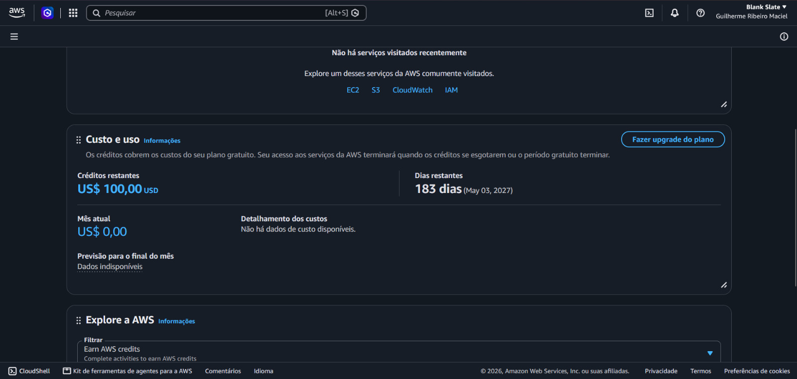

**Figura 1.** Painel de custos da AWS na data da captura, com o plano gratuito, os créditos e os dias restantes visíveis.

### 4.2 Instância e armazenamento

As capturas atuais do console mostram uma instância chamada `atv_final-Infra`, tipo `t3.micro`, em execução na zona de disponibilidade `us-east-2c`, região `us-east-2`, com três verificações de estado aprovadas. O endereço público estático associado é `18.116.161.154`.

A aba de armazenamento mostra um volume raiz EBS de 8 GiB, conectado e em uso, sem criptografia. EBS é o disco persistente associado à instância. A ocupação vista pelo Ubuntu em `df -h` não é o tamanho provisionado do volume, por isso as duas medidas são descritas separadamente. A documentação da AWS explica a criptografia dos volumes EBS e dos dados armazenados neles [11].

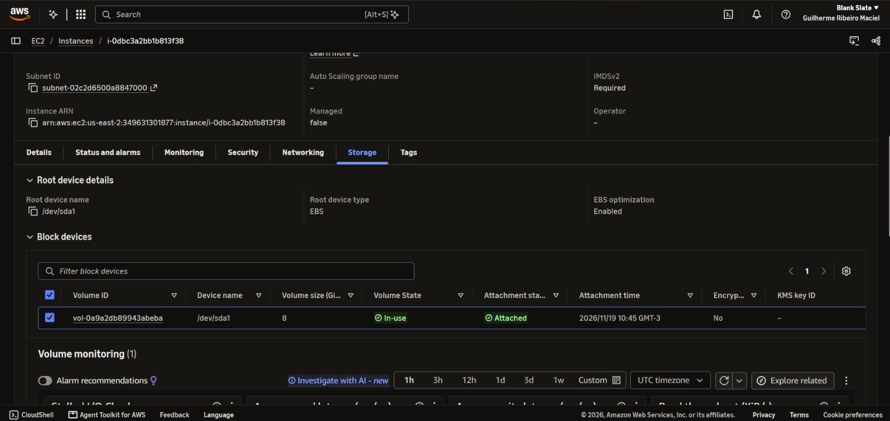

**Figura 2.** Aba de armazenamento da instância mostrando o volume EBS raiz de 8 GiB, em uso e sem criptografia.

O sistema operacional observado por SSH foi Ubuntu 26.04.1 LTS, arquitetura x86-64.

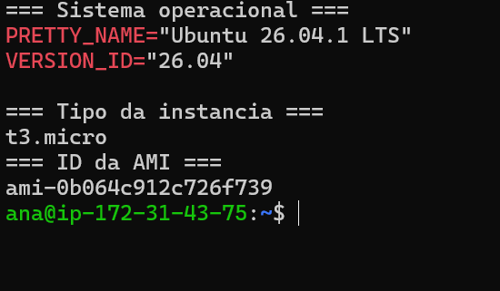

**Figura 3.** Saída do servidor que identifica Ubuntu 26.04.1 LTS, instância `t3.micro` e a AMI usada.

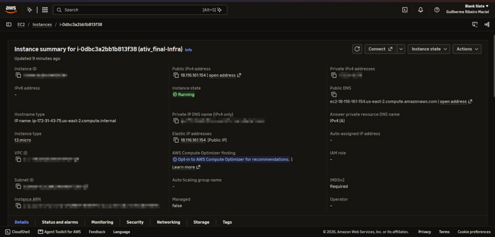

**Figura 4.** Detalhes da instância EC2, com nome, tipo, estado, endereço público estático e informações de rede necessárias à identificação do ambiente. Identificadores internos foram ocultados.

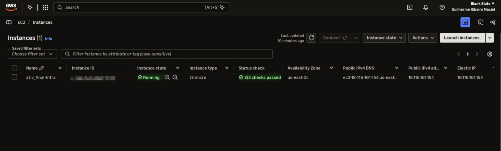

**Figura 5.** Lista de instâncias da AWS mostrando a instância PROEX em execução, tipo `t3.micro` e verificações de estado aprovadas. O identificador da instância foi ocultado.

## 5. Administração e acesso

O acesso remoto foi realizado por SSH com uma chave privada mantida localmente. O usuário conectado foi `ana`, com permissão para usar `sudo`, comando que permite executar tarefas administrativas autorizadas. A unidade do backend usa o usuário de sistema `proex`, separado da conta de administração, para executar o serviço.

Chaves privadas, senhas, tokens e valores reais de configuração não são reproduzidos neste relatório.

## 6. Publicação do PROEX

O backend está instalado em `/opt/proex` e é iniciado pelo comando `java -jar /opt/proex/backend-1.0.0.jar`, conforme a unidade systemd configurada. O frontend foi executado no Expo Go durante a demonstração. A configuração local `EXPO_PUBLIC_API_URL` aponta para a API pública da EC2 através do Nginx, sem tornar o computador pessoal o servidor da API.

O fluxo registrado foi:

| Ação | Resultado HTTP observado | Significado |
| --- | --- | --- |
| Cadastro em `POST /usuarios` | 201 | Usuário de teste criado |
| Login em `POST /login` | 200 | Credenciais de teste aceitas e sessão iniciada |
| Consulta em `GET /usuarios/me` | 200 | Perfil próprio consultado com sessão autenticada |
| Encerramento em `POST /logout` | 204 | Sessão encerrada sem corpo de resposta |

As chamadas foram feitas com uma conta descartável, e suas credenciais não são reproduzidas neste relatório. O endereço usado na demonstração foi `http://18.116.161.154`.

### 6.1 Demonstração em vídeo

Para complementar os resultados HTTP apresentados nesta seção, o vídeo demonstra o cadastro de um perfil de teste e o login subsequente no aplicativo PROEX executado pelo Expo Go. A gravação não contém credenciais reais nem tokens.

**Arquivo de vídeo:** [Demonstração do cadastro e login no Expo Go](evidencias/video-demonstracao-cadastro-login-expo-go.mp4).

## 7. Segurança, rede e HTTPS

### 7.1 Regras de entrada

O Security Group exibido no console apresentava duas regras SSH na porta TCP 22, restritas a endereços IPv4 individuais com máscara `/32`, e uma regra HTTP na porta TCP 80 com origem `0.0.0.0/0`. A lista apresentada não incluía regras de entrada para HTTPS na porta 443, para a API na porta 8080 nem para MySQL. A documentação da AWS explica como as regras de grupo de segurança controlam o tráfego permitido e como se especificam origens e portas [8].

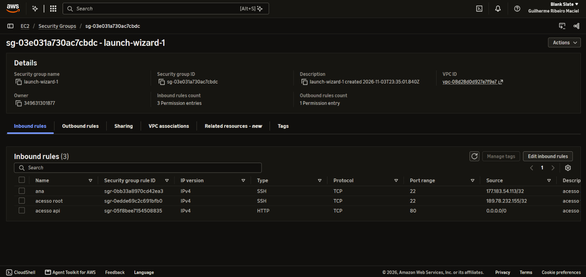

**Figura 6.** Regras de entrada exibidas no console AWS: SSH na porta 22 limitado a endereços IPv4 `/32` e HTTP na porta 80 aberto para `0.0.0.0/0`.

### 7.2 Portas em escuta e banco de dados

Na verificação com `ss -lntp`, Nginx foi observado na porta 80, SSH na porta 22, Java na porta 8080 e MySQL nos endereços locais `127.0.0.1:3306` e `127.0.0.1:33060`. O MySQL, portanto, aceitava conexões somente a partir da própria instância. O aplicativo alcançou a API pelo Nginx na porta 80.

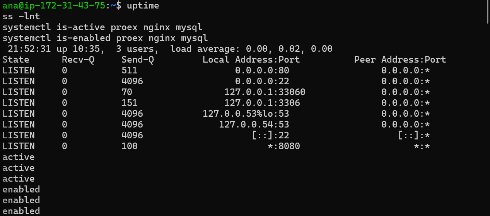

**Figura 7.** Saída do servidor mostrando portas em escuta e os serviços PROEX, Nginx e MySQL ativos e habilitados.

### 7.3 DNS e HTTPS

O aplicativo mobile acessa a API por uma URL configurável. Como a EC2 recebeu um IPv4 público estático, o grupo optou por usar esse endereço diretamente no aplicativo e não criar um nome DNS. A AWS permite associar um endereço IP elástico à instância; para o fluxo demonstrado, o DNS acrescentaria um nome mais fácil de memorizar, mas não era necessário para localizar a API [9].

O grupo também optou por manter a publicação em HTTP na arquitetura existente, composta por uma EC2 e o Nginx como entrada para o backend. Essa decisão considerou que a Let’s Encrypt disponibiliza certificados para endereços IP com validade de 160 horas, pouco mais de seis dias, o que requer renovação frequente. No procedimento `webroot`, é necessário Certbot 5.4 ou superior; no momento da consulta, o Certbot emitia esses certificados, mas ainda não os instalava automaticamente no servidor web. Para usá-los no Nginx seria necessário configurar a leitura do certificado, a renovação e um gancho para recarregar o serviço [3][4]. O grupo manteve o endereço IP elástico já associado à EC2 e não criou um registro DNS, pois o endereço estático já atendia à necessidade de acesso do aplicativo. A AWS mantém uma página própria com os valores cobrados pelos endereços IPv4 públicos [5][9].

Os testes funcionais documentados usaram uma conta descartável. O uso de HTTP, entretanto, não criptografa as solicitações; por isso, essa configuração não é apresentada como adequada para proteger credenciais ou dados reais [12]. Para uma implantação com domínio e terminação TLS gerenciada, uma alternativa de arquitetura seria associar um certificado do AWS Certificate Manager a um Application Load Balancer ou a uma distribuição CloudFront. A documentação da AWS recomenda certificados do ACM para Application Load Balancers e descreve os requisitos para usar certificados TLS no CloudFront [6][7]. Essa alternativa é distinta da arquitetura atual, que publica a API por meio do Nginx na EC2.

**Referências técnicas consultadas em 24 de novembro de 2026:** [certificados de IP e validade curta da Let’s Encrypt](https://letsencrypt.org/2026/01/15/6day-and-ip-general-availability), [procedimento atual do Certbot para certificados de IP](https://letsencrypt.org/2026/03/11/shorter-certs-certbot), [preços de IPv4 público da AWS em português](https://aws.amazon.com/pt/vpc/pricing/), [regras de grupos de segurança da AWS em português](https://docs.aws.amazon.com/pt_br/vpc/latest/userguide/security-group-rules.html), [associação de IP elástico à instância em português](https://docs.aws.amazon.com/pt_br/AWSEC2/latest/UserGuide/working-with-eips.html), [documentação oficial do módulo de proxy do Nginx](https://nginx.org/en/docs/http/ngx_http_proxy_module.html), [criptografia do Amazon EBS em português](https://docs.aws.amazon.com/pt_br/ebs/latest/userguide/ebs-encryption.html) e [definição de HTTPS em português pela MDN](https://developer.mozilla.org/pt-BR/docs/Glossary/HTTPS).

### 7.4 Segredos e registros

O arquivo `.env.example` é um modelo com os nomes das variáveis de ambiente e sem valores preenchidos. A unidade de serviço referencia o arquivo `/etc/proex/.env`, separado do repositório. O backend recebeu um tratamento de erros de validação que retorna uma mensagem genérica e evita registrar os valores rejeitados. Após a publicação da versão atualizada na EC2, a equipe validou o comportamento com dados fictícios e confirmou que o valor de senha usado no teste não apareceu no journal. A alteração também foi compilada e registrada no Git.

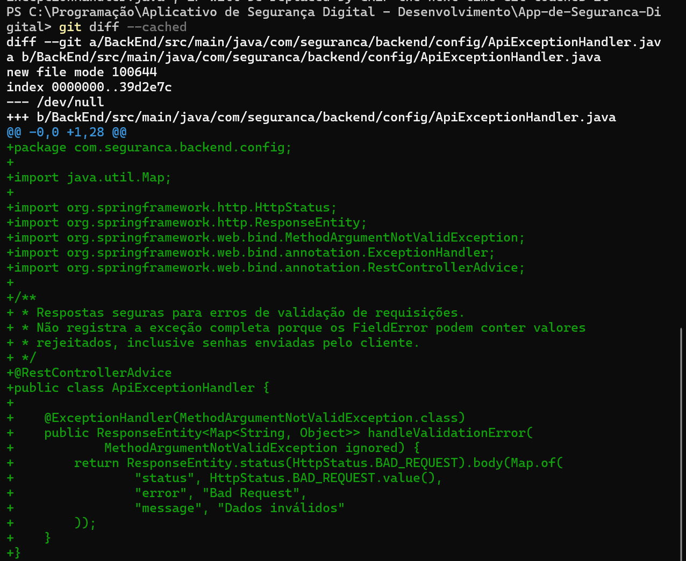

**Figura 8.** Trecho da implementação do `ApiExceptionHandler`, que devolve uma resposta genérica para erros de validação e evita registrar os valores rejeitados.

## 8. Serviços e inicialização automática

A captura abaixo mostra a unidade `proex.service`. O backend é executado pelo usuário de sistema `proex`, no diretório `/opt/proex`, com reinício após falha e intervalo de cinco segundos. A unidade referencia, de forma opcional, o arquivo de variáveis `/etc/proex/.env`.

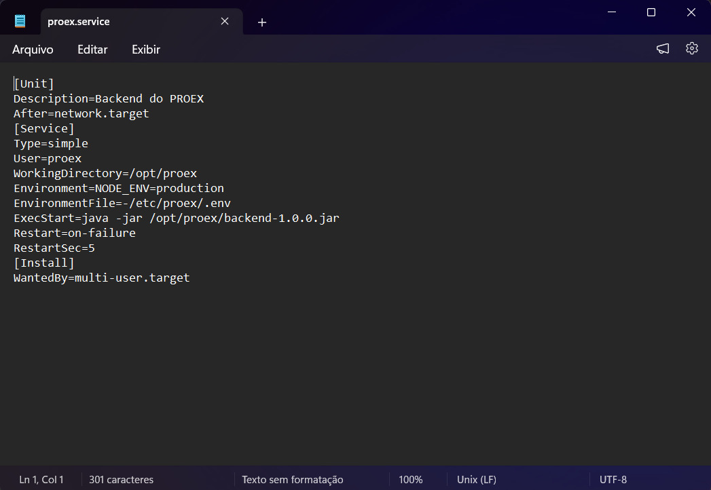

**Figura 9.** Unidade systemd usada para executar o backend. A configuração indica o usuário de serviço, o caminho do artefato, a política de reinício e o arquivo externo de variáveis. A imagem não contém valores de credenciais.

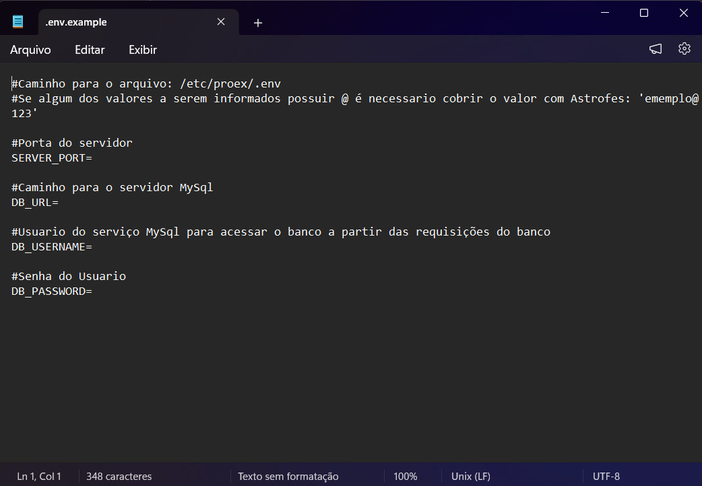

**Figura 10.** Modelo `.env.example` com os nomes das variáveis de porta e conexão do MySQL, sem valores preenchidos. A imagem não deve ser confundida com o arquivo `.env` real do servidor.

Os serviços `proex`, `nginx` e `mysql` apareceram ativos e habilitados. A configuração do Nginx foi validada com `sudo nginx -t`, que informou que a sintaxe estava correta e que o teste da configuração foi bem-sucedido.

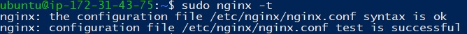

**Figura 11.** Resultado de `sudo nginx -t`, que confirmou a sintaxe válida da configuração do Nginx.

## 9. Monitoramento e registros

Em 24 de novembro de 2026, às 17:18 UTC, a coleta informada mostrou uptime aproximado de um dia e seis horas, médias de carga de 0.00, 0.02 e 0.00, 908 MiB de RAM total, 311 MiB disponíveis, 1.0 GiB de swap com 512 MiB usados e partição raiz de 6.7 GB, com 4.6 GB usados, 2.1 GB disponíveis e 70% de ocupação. Esses números são uma fotografia daquele instante, não uma medição contínua de desempenho.

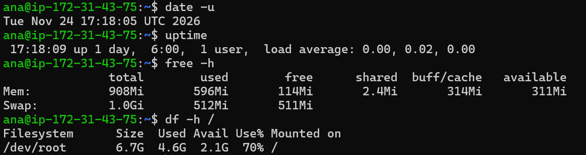

**Figura 12.** Saídas de `date -u`, `uptime`, `free -h` e `df -h /`, com a data e os valores de carga, memória, swap e disco registrados.

O log de acesso do Nginx registrou o fluxo funcional em 23 de novembro de 2026. O cadastro retornou 201, o login retornou 200, a consulta do perfil retornou 200 e o logout retornou 204. Também houve respostas 401 quando uma rota protegida foi consultada sem autenticação e 404 para a raiz do servidor, que não corresponde a uma página inicial do aplicativo.

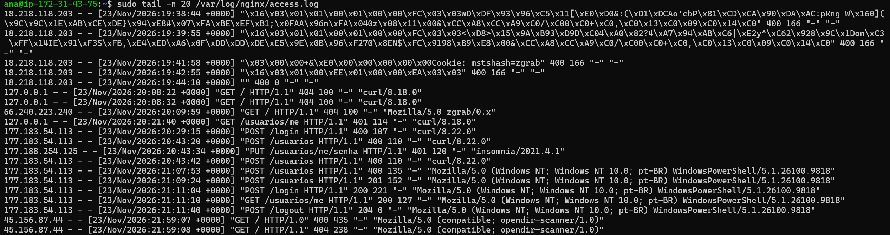

**Figura 13.** Trecho do log de acesso com os códigos HTTP observados nas chamadas da API. As linhas também registram solicitações sem relação com o fluxo funcional.

Os registros do serviço confirmaram que o Tomcat iniciou na porta 8080 e que o pool de conexões Hikari iniciou conexão com MySQL.

### 9.1 Reinicialização da instância e retorno dos serviços

Após a publicação da versão atualizada do backend, a instância EC2 foi reiniciada. Na consulta realizada em 24 de novembro de 2026, às 19:55 UTC, `proex`, Nginx e MySQL estavam ativos. O estado do systemd indica que PROEX e Nginx iniciaram às 19:47:30 UTC e MySQL às 19:47:34 UTC. No console AWS, a instância aparecia em execução com os três status checks aprovados.

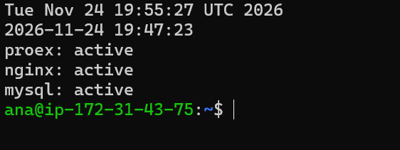

**Figura 14.** Horário da consulta e confirmação resumida de que os três serviços estavam ativos após a reinicialização.

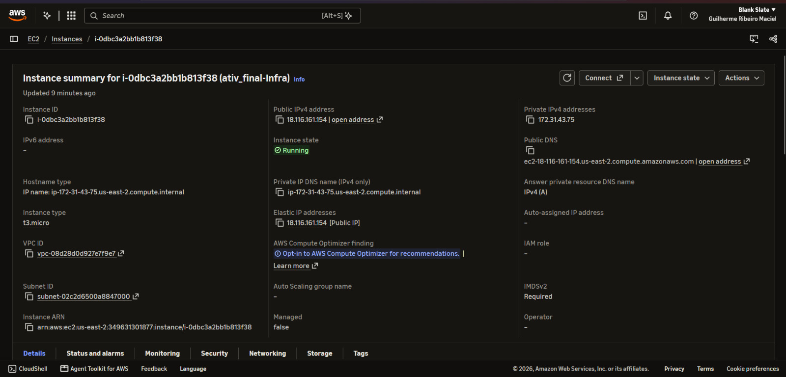

**Figura 15.** Console AWS mostrando a instância em execução e o Elastic IP associado após a reinicialização. Identificadores internos foram ocultados.

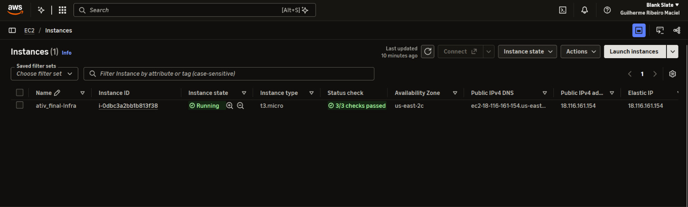

**Figura 16.** Lista do console AWS mostrando a instância em execução e os três status checks aprovados após a reinicialização.

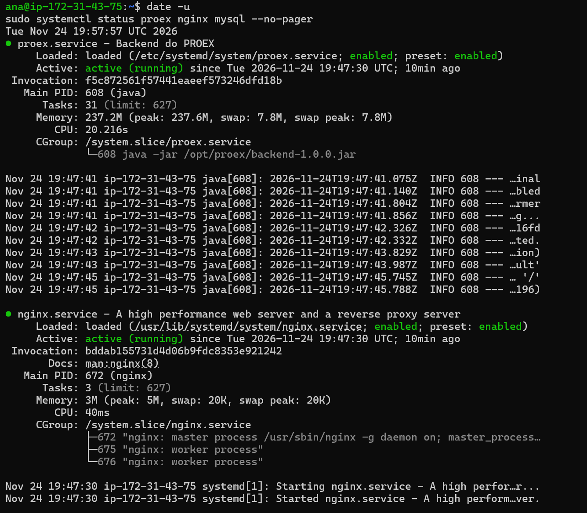

**Figura 17.** Saída do systemd para PROEX e Nginx, com estado ativo e horário de início após a reinicialização.

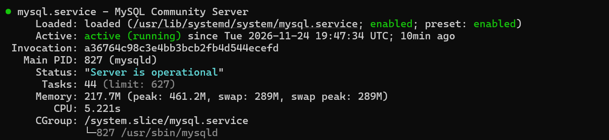

**Figura 18.** Saída do systemd mostrando o MySQL ativo e operacional após a reinicialização.

### 9.2 Interrupção controlada e recuperação do backend

Em 24 de novembro de 2026, às 21:50 UTC, o serviço PROEX foi interrompido de forma controlada. Durante a interrupção, `systemctl is-active` indicou `failed` e a chamada direta à porta 8080 retornou `HTTP 000`, ou seja, não recebeu resposta HTTP. Às 21:56 UTC, após iniciar o serviço, ele voltou a `active`, a porta 8080 estava em escuta e uma chamada à rota protegida através do Nginx retornou `HTTP 401`. Sem token de autenticação, esse resultado confirma que a API voltou a responder.

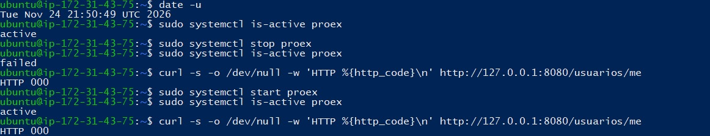

**Figura 19.** Registro da interrupção: o serviço estava indisponível e não houve resposta HTTP na porta 8080.

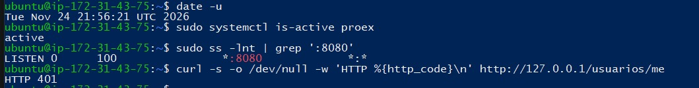

**Figura 20.** Registro da recuperação: PROEX ativo, porta 8080 em escuta e resposta HTTP 401 da rota protegida via Nginx, sem autenticação.

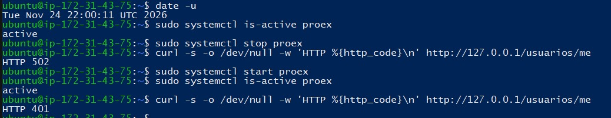

**Figura 21.** Teste complementar pela porta pública local do Nginx: durante a parada do backend, a solicitação retornou HTTP 502; após iniciar o serviço, ele ficou ativo e a rota protegida retornou HTTP 401, resposta esperada sem autenticação.

## 10. Testes realizados

### 10.1 Acesso à API e autenticação

**Objetivo:** verificar se o backend hospedado responde a operações reais do aplicativo.

**Procedimento:** o aplicativo foi executado no Expo Go com a URL pública da API. Uma conta descartável foi cadastrada, usada para login, consultada em `/usuarios/me` e desconectada.

**Resultado:** os registros de acesso mostraram `POST /usuarios` com HTTP 201, `POST /login` com HTTP 200, `GET /usuarios/me` com HTTP 200 e `POST /logout` com HTTP 204.

**Interpretação:** o fluxo testado atravessou o acesso HTTP público e chegou às funções de cadastro e autenticação do backend.

### 10.2 Teste leve de acessos simultâneos

**Objetivo:** observar se o servidor atende solicitações de leitura próximas no tempo.

**Procedimento:** foram enviadas cinco consultas simultâneas e autenticadas para `GET /usuarios/me`, sem operações de escrita.

**Resultado:** as cinco respostas observadas foram HTTP 200.

**Interpretação:** as cinco solicitações de leitura foram atendidas com sucesso naquele teste. O ensaio é de baixa intensidade e não mede a capacidade máxima do servidor.

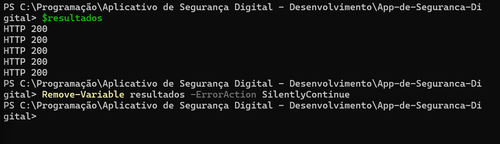

**Figura 22.** Saída do PowerShell com cinco respostas HTTP 200 para as consultas simultâneas ao perfil autenticado.

### 10.3 Validação do Nginx

**Objetivo:** verificar a sintaxe dos arquivos de configuração do Nginx antes de depender do serviço.

**Procedimento:** execução de `sudo nginx -t` na EC2.

**Resultado:** o Nginx informou que a sintaxe estava correta e que o teste da configuração foi bem-sucedido.

**Interpretação:** a configuração carregada passou pela verificação sintática do Nginx.

## 11. Continuidade, inventário e conclusão

### 11.1 Backup e restauração do banco

O arquivo `backup.sql` foi mantido fora do repositório e restaurado em uma cópia isolada do banco. A consulta à tabela de usuários confirmou a presença dos registros recuperados. O arquivo SQL não foi incluído no repositório.

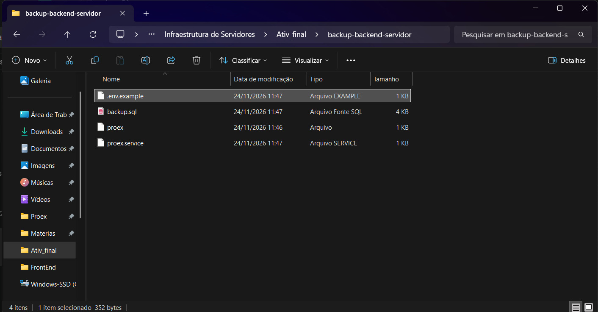

**Figura 23.** Lista de arquivos da pasta externa de backup, incluindo `backup.sql`.

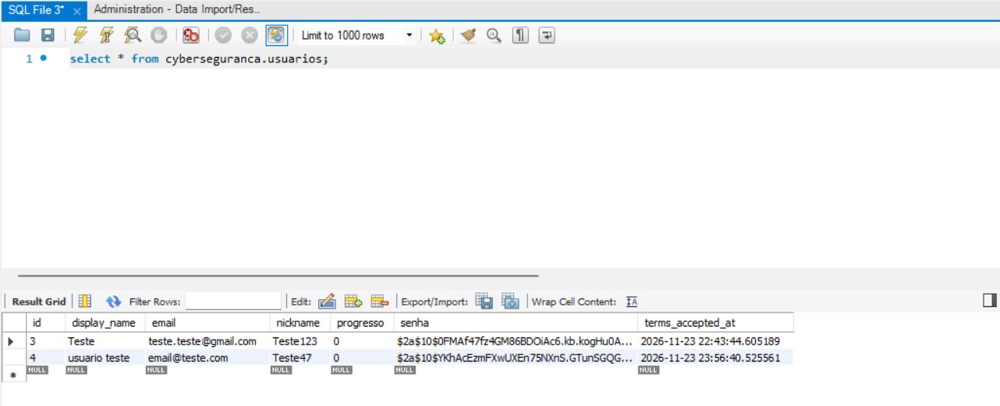

**Figura 24.** Resultado da consulta após a restauração da cópia do banco. Os registros exibidos são contas de teste; a tela mostra hashes de senha, não senhas em texto aberto.

O ambiente documentado utiliza uma instância EC2 `t3.micro` na região `us-east-2`, com Ubuntu Server, um volume raiz EBS de 8 GiB e um Elastic IP. A publicação utiliza Nginx na porta 80, backend Java com Spring Boot na porta 8080 e MySQL em conexões locais. O volume raiz aparece sem criptografia.

O grupo demonstrou que o backend real do PROEX está publicado em uma instância EC2 e que o fluxo de cadastro e autenticação responde pelo endereço público através do Nginx. Foram registrados os parâmetros principais da instância, as portas observadas, o estado dos serviços, métricas do servidor, os códigos HTTP do fluxo funcional, a recuperação após reinicialização e após interrupção controlada do backend, a restauração de uma cópia do banco e um teste leve com cinco consultas simultâneas. O endereço público estático permitiu ao aplicativo alcançar a API sem a configuração de DNS.

## 12. Referências

1. NERES, Lucca Abbado. *Infraestrutura de Servidores: Projeto Final, PROEX em Produção. Implantação, administração, segurança, monitoramento e recuperação de uma aplicação real na Amazon Web Services*. Material da disciplina, 2026.
2. Repositório do projeto Aplicativo Educacional de Segurança Digital e Segurança da Informação. Código e documentação do frontend mobile e do backend Java/Spring Boot.
3. Let’s Encrypt. *6 day and IP Address Certificates are Generally Available*. Consulta em 24 de novembro de 2026. https://letsencrypt.org/2026/01/15/6day-and-ip-general-availability
4. Let’s Encrypt. *Six-Day and IP Address Certificates Available in Certbot*. Consulta em 24 de novembro de 2026. https://letsencrypt.org/2026/03/11/shorter-certs-certbot
5. Amazon Web Services. *Preços da Amazon VPC: endereço IPv4 público*. Consulta em 24 de novembro de 2026. https://aws.amazon.com/pt/vpc/pricing/
6. Amazon Web Services. *Certificados SSL para o Application Load Balancer*. https://docs.aws.amazon.com/pt_br/elasticloadbalancing/latest/application/https-listener-certificates.html
7. Amazon Web Services. *Requirements for Using SSL/TLS Certificates with CloudFront*. https://docs.aws.amazon.com/AmazonCloudFront/latest/DeveloperGuide/cnames-and-https-requirements.html
8. Amazon Web Services. *Regras de grupos de segurança*. https://docs.aws.amazon.com/pt_br/vpc/latest/userguide/security-group-rules.html
9. Amazon Web Services. *Para associar um endereço IP elástico a uma instância*. https://docs.aws.amazon.com/pt_br/AWSEC2/latest/UserGuide/working-with-eips.html
10. NGINX. *Module ngx_http_proxy_module*. https://nginx.org/en/docs/http/ngx_http_proxy_module.html
11. Amazon Web Services. *Criptografia do Amazon EBS*. https://docs.aws.amazon.com/pt_br/ebs/latest/userguide/ebs-encryption.html
12. Mozilla Developer Network (MDN). *HTTPS*. https://developer.mozilla.org/pt-BR/docs/Glossary/HTTPS
